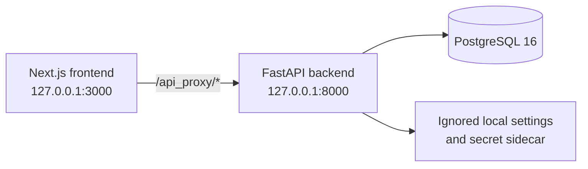
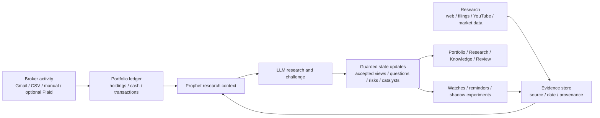

# Prophet Architecture

This document describes the repository as it exists today. It is intentionally
smaller than the historical design plan that preceded the implementation.
Source code, migrations, and tests remain authoritative when this document and
the implementation disagree.

## Scope

Prophet is a local-first, single-user investment intelligence system. It
combines a deterministic portfolio ledger with dated evidence, persistent
research state,
model-assisted analysis, guarded belief updates, monitoring, and simulated
decisions. It does not connect to a live execution venue or place real orders.

Two application processes and one database make up the normal runtime:



The frontend rewrite is configured in `frontend/next.config.ts`. FastAPI mounts
all application routers under `/api` in
`backend/investos/api/routes/__init__.py`. The backend rejects non-loopback API
clients by default and restricts browser state changes to configured frontend
origins. This is a local safety boundary, not multi-user authentication.

The launcher passes the backend source fingerprint at startup and embeds the
frontend source fingerprint in the production build. Each service reports its
fingerprint and non-secret launch identity; a standalone or older process can
report an unknown build. A launcher publishes a private rendezvous only after
both of its children report the same launch identity. Stop and restart verify
that identity and authenticate a loopback request to the supervisor, which
owns the child handles and performs shutdown. Browser routes cannot request
launcher shutdown.

## End-to-End Data Flow



The two left-hand lanes have different truth rules. Portfolio quantities and
cash are reconstructed by deterministic services. Research enters as evidence
with provenance and is not accepted merely because a model produced it.

## Inputs

### Portfolio activity

`api/routes/portfolio.py` exposes manual transactions, CSV/text imports,
position reconciliation, corrections, and research-object creation.
`services/portfolio.py` and `services/transaction_provenance.py` own ledger
replay and source receipts. `services/mailbox.py` parses scoped Gmail or IMAP
broker messages, including supported corrections and corporate actions. The
optional Plaid path is isolated behind `services/brokerage.py` and integration
routes.

The model may help classify an ambiguous document, but it cannot directly set
positions, cash, fills, or prices. Those values are accepted only through the
portfolio and reconciliation services.

Cash entries are ordered by their effective execution time. Late arrivals update
subsequent cash balances under the same database lock used by cash replay.
The overview's legacy `buying_power` field represents reconstructed cash (or the
configured fallback), not broker-confirmed purchasing capacity. Its `total_value`
is an estimate of marked holdings plus that cash. Independently observed broker
statements retain their own reconciliation receipts; missing activity, unsettled
funds, margin and unmatched quantities must not be patched with a balancing entry.

### Research and market evidence

Structured extraction retains all generated events, facts, claims, supported
subjects, metrics and setup signals through the existing relevance and
source-grounding boundaries. URL intake and research intake retain the full
fetched text within the existing fetch byte/time limits, without a separate
20,000-character prefix cut. Historical investment-object reindexing retains
the complete returned metric/signal lists as well. Live extraction reads the
retained UTF-8 representation in contiguous windows, with preceding overlap.
`EVIDENCE_EXTRACTION_WINDOW_CHARS` and `EVIDENCE_EXTRACTION_OVERLAP_CHARS`
bound each call, not the total source length. The existing extraction queue
resumes unseen text; successful windows do not consume the failure-retry budget.
Objects and the completed-window checkpoint commit together. Source/intent
hashes prevent continuation against changed text, and exact repeated generated
objects are suppressed without merging conflicting statements.

Historical investment-object and relationship reindexing use the same windows
and retain their existing call budgets and write boundaries. A retained text
fallback is identified separately from the original stored representation;
model-written summaries are not substituted for source text. Relevance review
also continues in windows and does not quarantine a source from a partial view.
An explicit relevance or relationship repair call advances one window; its
receipt reports remaining work. Live extraction postpones watcher evaluation
and subject analysis until every stored text window has been submitted.

Receipts and retrieval context distinguish unknown, partial and all-text-submitted
coverage. Offsets count Unicode codepoints and identify the inspected source
hash. This is input coverage, not proof of complete fact recall, semantic
entailment, image coverage or reconciliation across distant sections. Original
source bytes remain available for inspection. Legacy completed sources retain
unknown coverage; this does not silently replay completed backfill jobs.

New extracted facts, claims and events carry a supporting quotation in their
existing creation-audit record. A unique whitespace-tolerant text match binds
the original spelling to Unicode codepoint offsets and a source hash; the
assertion hash prevents an edited statement from inheriting an old anchor.
Ambiguous, missing or stale matches remain explicit gaps. Graph details and
retrieval use the same projection, including source context before and after
the quote. Prompt compaction keeps the quotation intact. Context is an excerpt,
not a whole-source coverage claim. The original-text reader can validate a
historical anchor against retained bytes when SourceItem contains a legacy
prefix. This reuses the [W3C quote/position selector pattern](https://www.w3.org/TR/annotation-model/#selectors),
without treating a lexical match as semantic entailment or independent
corroboration. Original and derived statements remain separately inspectable;
this does not automatically rewrite accepted views or supersede earlier facts.
The graph inspector labels unverified facts/claims explicitly; their stored
tier classification and promotion eligibility remain available in record details.

`api/routes/ingestion.py` accepts notes, files, and URLs. Research discovery and
extraction run through `services/research.py`, `workers/research.py`, and
`workers/extraction.py`. The Sources routes and services manage provenance,
feedback, ownership disclosures, market-setup signals, fundamental metrics,
and YouTube transcript workflows. Market prices and benchmark context are
handled separately by the market-data and risk services.

`services/portfolio_risk.py` captures availability-aware daily portfolio stress
packets in the existing scenario store and evaluates explicit owner loss-budget
watches. The existing push outbox handles opt-in advisory delivery. This
deterministic path is separate from the benchmark regime and does not require
the LLM. See [Portfolio daily-risk advisories](portfolio-risk.md) for its
calculation, timing and validation boundaries.

The notification outbox retains generic watch transitions even with no Web Push
subscriptions. Opted-in open pages read ordered, bounded event pages through
`GET /notifications/events`; the first read establishes a baseline rather than
replaying history. Device-specific test events are excluded. This read path
shares event tags with Web Push, creates no delivery/subscription records and
respects the host notification switch. Browser permission, local opt-in and
closed-app push readiness remain separate states.

External web discovery runs through a provider registry. A configured SearXNG
endpoint is the free-first path; configured Tavily is a metered fallback when
the earlier provider fails or returns no usable candidates. A successful first
provider stops the chain. Search snippets remain provisional: research ingestion
fetches the underlying page through `core/url_security.py` when possible and
records discovery provider, source URL, content origin, and fallback attempts.
Each candidate is also retained as a dated `ResearchDiscoveryObservation` with
its query, rank, snippet or provider-content kind, fetch outcome, and eventual
evidence link. These observations support provenance and later pattern review;
they are not `RawEvidence` and cannot satisfy corroboration or accepted-state
promotion.
Publisher RSS/Atom intake uses `feedparser` over bytes fetched through the same
bounded public-URL guard. Durable `PublisherFeed` subscriptions retain their
pause choice, coverage checkpoint and fetch lease. The default feed set is
configurable and claims no complete market coverage. Intake runs independently
of the model circuit: new and changed headlines are batch-retained as provisional
discovery, and bounded source-page fetches enter the normal extraction queue.
An editorial-priority lane and an oldest-lead slot share fetch capacity; retry
backoff, fenced leases and raw-receipt recovery preserve interrupted work.
Failed or unverifiably dated items remain inspectable rather than becoming
accepted claims. A changed live-page headline gets a new discovery timestamp;
its original publisher date never implies earlier system availability.
Recently checked, dated publisher summaries also enter the normal broad
portfolio question's fresh context. They remain clearly provisional, with
source receipts and recorded coverage limits. Sources exposes feed controls,
retained observations, fetch state and unsent research drafts.
Prompt compaction retains a bounded candidate manifest and search-coverage
receipts independently of excerpt capacity. Excerpts share capacity across
search lanes; omitted content and candidates are explicit. Publication,
observation, receipt and packet-assembly metadata survive repeated compaction
for analysis and critique. Undated monitors remain distinct from dated events.
URL documents use Python's HTML parser to omit executable script and style
content; document parsing runs off the API event loop. Navigation and publisher
boilerplate can still remain, so a fetched page is not a verified article claim.
Neither search provider is Prophet's retrieval system or a market-news
completeness guarantee. Whole-portfolio current-news checks
request the providers' news category and publication filters, then independently
reject missing, future, or out-of-window publication metadata. The default
window is 24 hours. Rejected observations retain their disposition and the
search window; dated snippets remain provisional, not corroborated facts.
Market searches can surface material unheld companies without requiring a held
ticker in the headline. Holding-specific searches cover the requested book in
priority order, batched by `CHAT_RESEARCH_HOLDINGS_PER_QUERY` (default 3) with
`CHAT_RESEARCH_MAX_HOLDING_QUERIES` as an optional owner-configured request bound
(default 0, no query-count cap). The existing provider credit budget still
applies. Every holding receives a search receipt:
candidate found, no matching candidate, provider/budget refusal, or not searched
because of the request limit. These receipts survive prompt compaction and are
visible in chat separately from stored evidence links. Candidate matches and
search misses do not establish verified facts or exhaustive coverage.
The turn's semantic classifier also selects its primary subject. Its selection
takes precedence over lexical ticker matches when resolving context, so naming
one held company as an example does not narrow a whole-portfolio question.
An explicitly pinned subject remains authoritative; model-unavailable fallback
resolution cannot provide the same semantic guarantee.
The classified company or thematic question also survives a missing stored
subject and a research-planner timeout. Its query and question-specific coverage
travel through the existing research plan, evidence packet and receipt; the
portfolio can remain a storage/context anchor without becoming the research
objective. Query-matched evidence and focused source checks remain available
without creating an issuer, theme or accepted thesis merely to anchor a question.
Unmatched questions preview subject-state changes rather than promoting them
against that portfolio anchor. Known entities can resolve without a security
record. Receipts and saved-chat labels retain the question scope, and genuine
same-session follow-ups reuse it unless a new scope or manual pin is supplied.
Query expansion and portfolio-anchored topic retrieval rank existing keyword
candidates with PostgreSQL's built-in cover-density text-search rank before
recency, so newer generic word matches cannot win solely on ingestion time.
Ties use recency and stable identity. This is lexical relevance, not source
verification, semantic entailment or an exhaustive coverage claim. See
[PostgreSQL text-search ranking](https://www.postgresql.org/docs/16/textsearch-controls.html#TEXTSEARCH-RANKING).
Draft typing does not call the model. Submitted questions classify intent,
freshness and primary scope in one call with the configured model timeout.
Evidence-acquisition planning uses the same configured model deadline through
the shared call boundary. Durable read-only turns defer on provider timeouts
and resume planning; they do not save a literal-query fallback as a completed
semantic plan. Non-durable callers retain the explicit scoped fallback.
If interpretation is unavailable, ordinary investment analysis stops visibly
instead of silently guessing a narrower subject or using stale evidence.
Deterministic conversational and explicit operating fallbacks remain available.
In ingestion, a known candidate is reused without terminating the scan of the
remaining bounded candidates. Historical and static-fact research keeps its
ordinary unrestricted search path.

YouTube ingestion is
caption-first. A structured assessment of the available representation records
resolved points, material gaps, and requested follow-up capabilities. It may run
one bounded audio pass through explicitly enabled `yt-dlp`, `ffmpeg`, and OpenAI
Whisper CLI tools, or route one specific verification question through the
existing research service. Every pass retains its representation, trigger,
assessment, parent evidence, and source provenance; raw media remains temporary.

An independently enabled frame adapter can sample bounded frames and pass
Tesseract OCR text back through the same assessment and evidence path. It does
not provide general scene, expression, demonstration, or chart-geometry
understanding.

Automation can review explicitly operator-trusted YouTube channel sources. It
stores upload metadata as `ResearchDiscoveryObservation` before attempting a
bounded number of real transcript ingestions. Failed fetches remain provisional
and retryable; metadata alone never becomes evidence. An unavailable frame/OCR
request remains an explicit coverage gap. The current media boundary is
documented in `limitations.md`.

## Durable State

PostgreSQL is the source of durable application state. SQLAlchemy models live in
`backend/investos/models/`, and Alembic migrations live in
`backend/alembic/versions/`.

The main state groups are:

- **Portfolio truth:** `Transaction`, `Lot`, `Position`, and cash-ledger records.
  Position caches are not quote evidence. The nullable `quote_receipt_json`
  retains the latest source quote with symbol, currency, price, observation and
  source times, instrument and recorded share basis. `core/valuation.py` checks
  that receipt against the current position without fetching prices. The same
  mark feeds API position responses, overview/dashboard totals and research
  context. Exact recorded decimals are retained during validation before float
  presentation. Missing, stale, future, mismatched or unsupported marks produce
  null values with reasons. Quote coverage exposes a priced subtotal separately;
  a partial book has no full total, full-book weight or open-cost return. Missing
  cash-ledger evidence also leaves estimated total ledger value unavailable.
  Shared financial formatters distinguish unavailable values from measured zero.
- **Evidence and provenance:** `Source`, `RawEvidence`, `SourceItem`, source
  profiles, quality segments, source-performance history, and provisional
  `ResearchDiscoveryObservation` records.
- **Presentation derivatives:** `EvidenceTranslation` retains target language,
  actual source-text hash and recipe/provider provenance. Translation views do
  not enter extraction, corroboration or accepted-state promotion. See
  [Presentation language](presentation-language.md).
- **Structured knowledge:** `Fact`, `Claim`, `Event`, `FundamentalMetric`,
  `MarketSetupSignal`, `Entity`, `Theme`, aliases, and graph `Edge` records.
- **Research state:** `Profile`, `CoverageMap`, unresolved questions,
  `EvidencePacket`, `ReasoningRun`, `CritiqueRun`, and review-queue items.
- **Accepted belief:** `ConclusionState` plus an append-only sequence of
  `ConclusionRevision` records.
- **Monitoring and learning:** `ActiveWatcher`, decisions, verification runs,
  lessons, historical episodes, and source outcomes.
- **Opportunity discovery:** operator-selected universe members plus additive,
  provenance-preserving imports from tracked positions, researched entities, and
  latest stored benchmark snapshots; resumable coverage/cost runs; reviewable
  source-linked candidates whose assumptions remain separate from evidence; and
  immutable discovery observations evaluated later against dated benchmark and
  cash controls. Provider interruption retains the bounded run's unfinished
  subjects and original capture rather than marking them inspected or replacing
  its plan. Recovery resumes that run, respects newly paused subjects, and
  evaluates all successful inspections including those completed before the
  interruption. Query drafting receives that run's UTC clock to anchor recency.
  Deferred work is exposed as deferred in automation telemetry.
  A run whose owner lease is still occupied reports `busy` and its lease-expiry
  time. The coordinator wakes that exact run at expiry, independently of the
  cadence for new scans. Resumption uses the same fenced claim and cannot create
  a new run if its target already finished. Pausing discovery also prevents the
  pending lease wake from performing research.
- **Listing frontier:** optional exchange-directory intake stores listing rows
  separately from entities and securities. Complete, hashed directory snapshots
  update presence without changing holdings, quantities or operator exclusions.
  Explicit common/ordinary-share and depositary-share labels can enter a bounded
  preparation buffer; unresolved types, ETFs and test issues remain inspectable.
  Materialization reuses the canonical security catalog and existing discovery
  runner, retains the selected row's source basis, and preserves existing pause
  and priority choices. Directory refresh needs no inference provider. A newly
  available frontier wakes waiting discovery; completed scans retain the configured
  cadence. Model recovery wakes deferred discovery, not a duplicate completed run.
- **Simulation:** shadow experiments, account events, orders, fills, evidence
  wake-ups, results, and experiment-family learning state.

Source trust keeps operator intent separate from learned assessment. An explicit
operator trust choice remains authoritative until the operator changes it.
Prophet continues to score reliability, calibration, noise, value, and later
claim outcomes; disagreement creates a dated review recommendation instead of a
silent override. Sources whose trust was established by automated learning may
be promoted or demoted as their measured record changes.

Evidence models use event, publication, ingestion, and eligible-action times
from `models/base.py`. These timestamps preserve what happened, when it became
public, when Prophet learned it, and when it could have influenced a simulated
action. Ingestion is never a substitute for an unknown event date. The research
feed classifies evidence as current, scheduled, historical, undated, or due for
outcome review; historical evidence remains queryable for analogies and source
calibration without competing with current attention. Claims with an explicit
target date use that date for later outcome assessment, with horizon-based
review timing only as a fallback. Assessed outcomes update source-performance
history while the original claim and its provenance remain unchanged.

## Retrieval and Reasoning

The primary interactive path is `POST /api/agent/turn`, with a persistent job
variant for work that continues outside the request. `services/agent.py`
resolves the subject and requested operation. `services/retrieval.py` assembles
a bounded packet from direct evidence, connected evidence, contradictions,
historical analogies, lessons, source feedback, portfolio exposure, peers, and
cached risk context. Fresh external research may be requested when the stored
packet is stale or insufficient.

All model calls go through `backend/investos/core/llm.py` and the provider
capability registry in `core/providers.py`. The default path uses a hosted
provider. Local providers remain disabled unless explicitly enabled; Prophet
does not start Ollama or another local model process.

Model output is treated as a proposal. `services/reasoning.py` records the
analysis result and visible trace. `services/corroboration.py`,
`services/canonical_state.py`, inference policy, coverage state, and
`services/verification.py` decide whether a proposal can affect accepted state.
Material contradictions, unsupported assertions, weak source independence, or
unresolved evidence gaps can narrow or block promotion.

Pattern discovery uses the same `ReasoningRun` ledger with
`run_type=pattern_discovery`. Applying runs commit a captured input, source
registry, prompt/schema, requested provider/model and non-secret validation
configuration before generation. The unmodified structured proposal is committed
before admission; rejection, duplicate, provisional output, deferral, interruption and
failure remain distinct dispositions. Provisional output and its final receipt
commit together; a failed output transaction retains the earlier proposal.
Explicit `apply=False` previews remain write-free. A process crash can leave an
unfinished receipt, which is not evidence that a worker is still running.
The model cites short packet-local signal labels. An exact, frozen reference map
resolves these labels to canonical signal IDs before persistence and deduplication;
partial UUIDs and invented labels are rejected rather than guessed.

`GET /api/reasoning/pattern-reviews` paginates projected summaries; the existing
run trace endpoint loads the complete capture on demand. Ideas links to Pattern
reviews, where source attribution, unknown publication times, the proposed
mechanism, falsifier and next test can be inspected. Draft investigation prepares
an unsent Research question containing bounded proposal/source excerpts and the
full receipt link. It does not queue research, promise a later answer, accept a
conclusion or alter a position.

Account and calculated amounts also pass through `services/quantity_evidence.py`.
The ledger, stored portfolio-risk capture and cached performance-attribution
receipt supply immutable measurement references with value, unit, basis,
subject, snapshot and dates. Models select these references; they cannot create
measurements. Existing context paths remain inspectable but do not verify math.
Generation supplies a reference, display quote and occurrence; the verifier
resolves the immutable measurement itself. Decimal round-half-up at the quoted
precision permits readable currency, percentages and scaled displays without
a loose numerical tolerance. Verification retains both the canonical value and
the display value. Legacy supplied dimensions must still match; stale or partial
measurements and changed signs, scales or units remain unverified.
Risk replay checks current holdings identity, currency, quote freshness and price
coverage without fetching new prices. Complete valuation is distinct from having
enough observations for a stress estimate. Holdings marks exclude cash; ledger
cash is not broker buying power; dated Modified Dietz returns retain their own
period and denominator.

Generated assertions, material assumptions, source references, contradictions,
falsifiers and alternative explanations are retained in full before review and
persistence. Normal, thin and recovery paths do not truncate these verification
inputs to fit a preview. Operational watch-proposal admission remains separate.

Analysis, independent review and strategic goals check structured quantity
bindings. Final answer rewrites are checked before accepted-state updates. A
failed numerical check retains the generated proposal and receipt, qualifies
the delivered answer and blocks its decisions, new watches, shadow creation,
pruning and memory promotion. Qualitative research can continue. Chat exposes
matched dimensions and unresolved checks on demand, including an explicit
unverified state for historical records without a numerical receipt.
Independent-review callers pass the complete captured evidence packet to the
review service. Only the outbound model payload is compacted; deterministic
source-independence, duplicate and quantity checks use the complete snapshot.
When combined analysis requests provider deferral, the optional independent
review receives the same choice. A provider failure during review propagates
before conclusion updates or the final analysis commit.
Prompt compaction retains evidence IDs, publisher lineage, copy signatures,
authority, acquisition kind and distinct publication/event/ingestion clocks.
It preserves explicit false trust flags without inventing authority or dates.
Coverage and numeric validity are separate: a review's unverified amount blocks
promotion and numerical actions, while an otherwise partial answer can still
report attributable evidence and its gaps. Genuine off-topic or inadequate
coverage remains a blocked conclusion. Numerical banners qualify financial
quantities actually present in the delivered text; internal rejected amounts
remain inspectable in the review receipt.
When action planning times out, its no-action response reuses the ordinary
fallback renderer. The delivered response retains the completed summary,
explanation, evidence checks and assessed coverage gaps. Delivery quantity
validation and promotion/action limits still apply to that text.

Answer construction is separate from accepting an investment conclusion. The
turn interpreter can bind requested parts to literal spans of the user's
question; otherwise the full question remains the answer contract. The research
planner's expanded acquisition needs and optional enrichment cannot replace
that contract. Original questions and requested parts survive prompt compaction.
When a plan explicitly excludes owner-account context, outbound model prompts
retain relevant issuer research but omit account details; deterministic checks
still use the complete captured packet.

After independent review, a concise response pass answers the requested parts
using the review's assessed assertions and explicitly contingent assumptions.
Each part binds to the supplied assertions or to an assumption with a falsifier.
Missing, duplicate, mixed-scope and unbound references cannot create an answered
part. Measured replies also retain the typed quantity and delivery checks. A
partial explanation can remain useful while promotion stays blocked; optional
background does not erase it. Read-only covered questions reuse the no-action
renderer rather than generating an operating plan. Enabled action planning
cannot rewrite the assessed response or append unadmitted commitments. Actual
research admission and extraction status are appended separately; queued source
work does not establish a future chat-answer delivery.

## Accepted State and Graph

`ConclusionState` is the current accepted view for a subject. Evidence packets,
chat answers, profiles, and reasoning runs support or challenge that view but do
not replace it. Revisions retain history so an updated view does not erase how
the earlier conclusion was formed.

The knowledge graph is a retrieval and inspection structure over subjects,
evidence, claims, themes, positions, and explicit relationships. Graph registry,
edge-state, alias, integrity, pruning, and mutation-audit services keep graph
changes inspectable. The graph does not grant truth status to a connected node;
state promotion still passes through evidence policy.
An inspector route that reaches only the synthetic portfolio root remains
portfolio-level context with unresolved holding linkage. A context attachment
does not establish exposure or economic transmission; routes to actual tracked
holdings retain their identities and the indirect-relationship qualification.

Source-attributed relationships are cited `Claim` assertions with two role
edges (`relationship_subject` and `relationship_object`) and an open predicate
in `claim_type`. A grouped list of counterparties becomes individually cited
binary assertions. Literal quotation and document-name anchoring precede
persistence; a relationship quote can use contextual pronouns or shortened names.
The named endpoints and anchors remain inspectable with the claim. These checks
establish attribution, not semantic entailment or independent verification.
Claims retain source, event and observation clocks. Availability is bounded by
when the assertion was actually recorded, including retained-source recovery,
so later extraction cannot backdate actionable knowledge. The normal integrity
audit reports and conservatively repairs older violations with a mutation receipt.
Claims remain unverified until
separate evidence policy admits them. Historical roles do not create forecast
review deadlines. Source withdrawal uses the existing claim lifecycle. Rejected proposals remain
in the mutation audit as unadmitted diagnostics rather than disappearing or
entering the market-claim graph.
The map projects a direct, dashed relationship from an admitted assertion and
links it back to the supporting claim and source. It does not persist a second
edge that could outlive withdrawn evidence. Projection reuses batched node
reads, preserves per-source assertion identity, and is absent when its claim
or either endpoint is outside the admitted view. Ordinary cross-subject events,
facts and claims also retain their document-primary context, as investment
metrics already did. Subject kinds remain open; creating a product assertion
does not silently reclassify or consolidate existing issuer identities.

Workspace graph reads batch node and provenance dependencies within each
request while retaining per-node admission limits. Bounded neighborhoods share
each breadth-first frontier across branches, preserving branch edge order so a
large first branch cannot exhaust the view before its siblings contribute.
D3 runs layout and collision
resolution in a browser worker. Each connected component has its own force
simulation; D3 front-chain circle packing separates disconnected groups. Layout
coordinates are unbounded: camera fitting owns the viewport rather than a clamp
that can pile nodes against world boundaries. Aspect fitting expands spacing
without compressing collisions; explicit manual anchors take precedence. The
selected-group fit changes only the camera and retains the full map. Spatial
proximity and component membership do not establish a causal relationship.
Camera movement updates the SVG transform;
React updates label detail only at zoom thresholds and memoizes individual
glyphs so unrelated inspector or hover work does not redraw the whole scene.
Labels sit outside node circles and compensate for both camera and SVG viewBox
scaling. A bounded, priority-ranked label layer resolves text overlap in screen
coordinates once per animation frame; it does not filter graph records. Full
names remain available through the paged local node navigator and inspector.
Node and edge hit targets retain screen-sized geometry when the overview is
zoomed out. This retains the existing D3 layout, camera and stable node identity
rather than introducing another renderer to correct a text-coordinate defect.

## Structured model execution

Chat uses full-width assistant answers and compact user bubbles. Private uploads
are stored in `chat_attachments`, separate from research evidence, with their
original bytes, hashes and representation metadata. Choosing a file, dropping
it, or pasting an image uploads locally; model calls begin when the user sends
the question. PDFium extracts page-qualified text and renders PDF pages under
a shared mutex off the API event loop. Pillow validates and normalizes image
inputs. Word and spreadsheet readers retain text/tables/cell coordinates and
formulas without executing them; representation omissions are explicit.

Images and PDF page graphics use the configured provider's vision model in
documented provider-sized batches. Completed page observations are retained
and resumed after an interruption. These are provisional model readings, not
accepted facts. The main model answers from file representations with filename
and page/row/section references. Text-only provider recovery cannot replace a
failed image read. Health probes and cooldowns use the same endpoint,
credential and model identity; one model cannot clear or block a different
model's circuit. All hosted calls still share request pacing and concurrency
limits. NVIDIA's default image reader follows its documented
[Nemotron 3.5 Super VL API](https://docs.api.nvidia.com/nim/reference/nvidia-nemotron-3_5-super-vl-120b-a12b),
and can be changed in Settings independently of the main analyst model.

File references survive conversation reloads and follow-up questions. The
job record also retains file receipts and the context choice so a failed
question can be restored without uploading its files again. Background chat jobs
freeze their original file set, session and permission choice. Completed scope,
conversation context, hydrated evidence, source checks, analysis and review stages
are checkpointed in the existing single-instance job tracker, with database
references committed before the atomic file checkpoint. Transient provider
failures defer unfinished work through the existing provider circuit; it owns
the next eligible probe. Completed file readings and analysis stages are reused
after restart, and the evidence receipt retains its original assembly time.
Recovery does not silently refresh the graph or conversation beneath a paused
answer. Ask a new question when a fresh snapshot is needed. Stable job identity
on both conversation messages prevents replay from duplicating a committed
answer or a user message saved before an interruption. Deferred work is active,
cancellable and visibly waiting, rather than reported as completed analysis.
Permanent configuration/model errors stop the job. Before a turn can promote
state or execute actions, a durable replay barrier disables automatic recovery.
An interrupted turn beyond that boundary requires activity review and an
explicit retry; the tracker does not claim exactly-once action execution.
A completed response checkpoint can still be delivered without executing it
again.

The workspace header shares a single activity read model across routes. Active
chat jobs and automation dispatch membership describe current execution;
`last_status` remains the previous outcome and never proves a job is running.
Chat shows the current backend phase, elapsed time, a collapsible factual work
log and a stop control. Paused provider work uses a waiting indicator rather
than an animated working state. Stage announcements are emitted only when the
checkpointed stage actually runs; reusing saved work does not announce it as
new research. These summaries expose actions and evidence checks, not private
model reasoning.

Status polling does not overlap requests. The foreground chat owns its detail
poll; the global completion watcher takes over when the user leaves chat. A
temporary connection or proxy failure retains the saved question reference and
shows unknown progress until reconnection. Only an explicit `job_not_found`
response retires a missing job reference. Late snapshots and earlier completion
notices cannot replace a newer local question. Navigation uses the framework's
pending-link feedback and route loading boundary. Indeterminate work does not
claim a completion percentage or estimate.

The composer lets the user stop including prior files. Attachment turns never
execute portfolio actions, create watches, or promote uploads into research
evidence. Size, text and cell-processing limits are configurable and partial
representations are visible. Binary uploads use multipart requests and the
Next proxy's buffered-body allowance follows the configured file limit.

The hosted request limiter rechecks the provider circuit before and after
waiting for admission. A queued call denied admission is a deferral, not a new
provider failure. Shared recovery uses one transport attempt, the configured
generation timeout, and a lease covering that timeout. A successful connectivity
probe enters `recovering`, retaining failure history. One real request receives
a fenced lease; competing requests defer. Only successful real work marks the
provider healthy and clears backoff. Probe and work success timestamps are
separate. Cancellation releases its trial lease; expiry permits a new fenced
trial after a restart. This follows the standard
[half-open circuit breaker](https://learn.microsoft.com/en-us/azure/architecture/patterns/circuit-breaker)
pattern without raising provider quotas or bypassing admission limits.
Both transport retries and the durable circuit use the same parser for
[RFC 9110 Retry-After](https://www.rfc-editor.org/rfc/rfc9110.html#section-10.2.3)
seconds and HTTP dates. Server-requested waits are not shortened by local
backoff caps; long waits defer through shared health instead of occupying a
request worker.
Autonomous model work
waits for a verified configuration; deterministic maintenance can continue.
Health identities include model request options so an observed failure is not
silently transferred to a different protocol configuration. Old records remain
retained. Empty, truncated and schema-invalid responses cannot pass as success;
diagnostics retain protocol counts and finish codes rather than generated text.
The shared model-call boundary applies the caller's timeout, or the configured
default, to the complete asynchronous call. Admission waits, transport retries,
streamed progress, and response repair share that deadline; nested adapters do
not restart it. Cancellation closes transport contexts and releases admission.
An explicit deadline shorter than the configured shared generation budget
is a caller failure, not evidence that longer requests are unavailable. Its error
still reaches the job and a configuration-scoped timeout counter is retained;
it neither opens nor heals the shared circuit. Default-budget timeouts, connection
failures, HTTP authentication/quota/server errors and invalid responses still
use the existing shared failure and recovery rules. These counters record
retained history, not completed work or provider capacity.

Model-family request options are defined in `core/providers.py`. Ultra final
content controls follow [NVIDIA's documented recipe](https://docs.nvidia.com/dynamo/dev/recipes/nemotron-3-ultra).
Local Qwen structured requests use Ollama's supported thinking control and
schema format. Both local and hosted responses are validated in Prophet.
An explicit local model must resolve to that installed model, rather than
silently selecting another model or a cloud tag. Provider overrides use their
own endpoint/model configuration. Local execution remains explicit opt-in.

## Automation

`AutomationCoordinator` starts with the FastAPI lifespan and registers the
background operating jobs. Static and runtime settings determine which jobs are
enabled and their intervals. The implemented jobs cover:

- research and unresolved-question processing;
- evidence extraction and source-claim assessment;
- integrity, entity, theme, relation, and media cleanup;
- market prices, risk, fundamental freshness, and historical reindexing;
- Gmail sync and optional brokerage reconciliation;
- reflection, strategist, pattern-discovery, and watcher cycles;
- bounded opportunity-universe research and candidate evaluation;
- shadow discovery, paper-account refresh, and evidence wake-ups;
- database backup and job telemetry.

Jobs call the same domain services used by the API. Automation is not a bypass
around portfolio truth or accepted-state policy. Interval and startup triggers
only initiate cheap eligibility checks: model-backed work and user-facing
activity must still earn execution through due state, changed evidence,
portfolio relevance, unresolved uncertainty, or another concrete expected
information gain. Unchanged/no-op checkpoints may support deduplication and
telemetry, but are not presented as meaningful agent activity.

Research selection filters investment concerns before applying its batch size
and continues through ordered batches until it finds eligible work. Receipt
identity and reconciliation holds stay in their own review domain and cannot
consume the research queue's candidate window. Scanning never resolves those
holds or modifies the portfolio ledger.

Committed evidence intake, material extraction, actionable questions, and
shadow evidence receipts wake their existing workers through PostgreSQL
notifications. The application also wakes eligible work when the model probe
recovers. These signals contain only a category; the persisted queues own
eligibility and deduplication. Signals coalesce, share the same execution guard
as manual and interval runs, and retain existing model work budgets. Startup
and reconnect check durable queues after subscription. Interval checks remain
for external polling, time-based eligibility, and recovery if a signal is missed.

Completed extraction also wakes the existing portfolio planner. Its operating
snapshot includes newly processed source changes across intake types, including
unheld subjects, with distinct observation, publication and processing clocks.
The latest five eligible sources carry up to three non-deprecated assertions
each, using the ordinary retrieval provenance and original-passage projection.
These are explicit, provisional previews; full source records remain available.
Source/version/assertion identity participates in planner deduplication. Existing
execution, provider and quantity guards still apply. A qualifying policy or theme
research goal can execute using its question when no stock ticker applies.

## Frontend Surfaces

Shadow risk-statistic conventions and availability boundaries are documented in
[Shadow metrics](shadow-metrics.md).

The Next.js App Router pages under `frontend/src/app/` expose the implemented
workflows:

- **Portfolio and History:** holdings, transactions, corrections, and account
  history.
- **Research:** persistent conversations, live jobs, evidence, and agent action
  traces.
- **Feed and Activity:** dated research changes and background work.
- **Knowledge and Profiles:** graph exploration, subject dossiers, aliases, and
  source receipts.
- **Sources:** trusted and discovered sources, evidence, feedback, disclosures,
  metrics, and media capabilities.
- **Risk and Review:** concentration, attribution, benchmarks, verification, and
  review queues.
- **Ideas:** operator-bounded opportunity discovery, candidate review,
  assumption and evidence inspection, coverage telemetry, and paper-only
  handoff to Shadow Lab.
- **Experiments:** shadow theses, paper accounts, orders, fills, checkpoints,
  outcomes, and learning state.
- **Settings:** connector configuration, provider readiness, setup state, and
  automation status.

`frontend/src/lib/api.ts` is the typed client boundary. Shared navigation lives
in `frontend/src/components/AppNav.tsx`.

## Configuration and Secrets

`backend/investos/config.py` defines static environment settings. User-editable
provider and integration settings are layered by
`services/runtime_settings.py`. The default local settings file and its secret
sidecar live under the ignored `data/` directory. API responses expose readiness
and key-presence flags, not secret values. Opportunity-discovery cadence,
per-run breadth, revisit timing, and candidate lifetime are runtime controls;
each discovery run stores the limits it actually used.

The checked-in `.env.example` contains placeholders only. Runtime settings,
portfolio data, evidence, media workspaces, databases, backups, logs, and local
agent state are not part of the repository.

## Invariants

The following boundaries are intentional and should remain true as the system
evolves:

1. Portfolio truth, calculations, timestamps, and simulated fills are
   deterministic and auditable.
2. Raw evidence retains source lineage and time semantics.
3. The LLM organizes, investigates, and challenges; it is not a truth store.
4. Repeated copies from one publisher do not become independent confirmation.
5. Material unsupported claims cannot upgrade accepted state.
6. Exploration and historical analogies remain provisional until tested.
7. Provider failure cannot invent a trade, portfolio, evidence item, or
   successful state transition.
8. Shadow and paper workflows never place real orders.
9. Private runtime state and credentials remain outside Git.
10. The application remains loopback-only unless a separate authenticated
    deployment design is implemented and reviewed.

## Repository Map

```text
backend/investos/api/routes/  HTTP boundaries
backend/investos/models/      durable database models
backend/investos/schemas/     request and response contracts
backend/investos/services/    domain behavior and policy
backend/investos/workers/     research and extraction workers
backend/alembic/              database migrations
backend/tests/                synthetic backend regressions
frontend/src/app/             user-facing routes
frontend/src/components/      shared workflow components
frontend/src/lib/             API client and frontend helpers
scripts/                      development, verification, and operator tools
docs/                         current public contracts and limitations
```

The product name is Prophet. The Python package and default database retain the
historical name `investos`.

## Known Boundaries

Architecture describes implemented structure, not guaranteed analytical
quality. External data availability, model quality, connector coverage, test
depth, and simulation fidelity have explicit limits. See
[`limitations.md`](limitations.md) for the current boundary.
